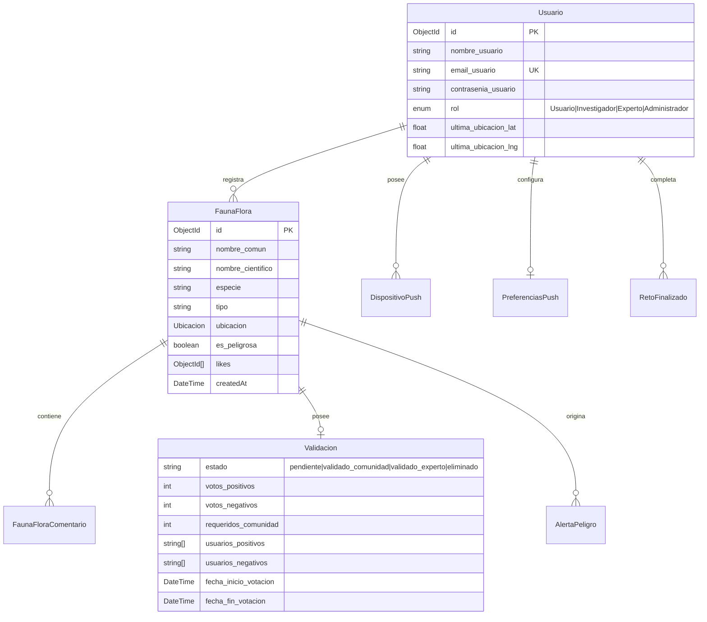

# 🌿 TerraScope Backend API

> **API RESTful y Motor en Tiempo Real para Monitoreo Ambiental, Gamificación, Clasificación por IA y Alertas de Biodiversidad.**

[](https://nodejs.org/)
[](https://expressjs.com/)
[](https://www.prisma.io/)
[](https://www.mongodb.com/)
[](https://socket.io/)
[](http://localhost:3000/api/docs)
[](LICENSE)

---

## 📌 Tabla de Contenidos

- [Descripción General](#-descripción-general)
- [Arquitectura de Software](#-arquitectura-de-software)
- [Stack Tecnológico](#-stack-tecnológico)
- [Modelado de Datos (Prisma / MongoDB)](#-modelado-de-datos-prisma--mongodb)
- [Módulos y Capacidades del Sistema](#-módulos-y-capacidades-del-sistema)
  - [1. Validación Comunitaria y Ventana Temporal (MVP04)](#1-validación-comunitaria-y-ventana-temporal-mvp04)
  - [2. Alertas Geoespaciales y Protocolo SOS](#2-alertas-geoespaciales-y-protocolo-sos)
  - [3. Clasificación y Validación por IA (Google Gemini)](#3-clasificación-y-validación-por-ia-google-gemini)
  - [4. Gamificación y Patrón Observer (Retos y Certificados)](#4-gamificación-y-patrón-observer-retos-y-certificados)
  - [5. Notificaciones Push (Firebase Admin SDK)](#5-notificaciones-push-firebase-admin-sdk)
- [Estructura del Proyecto](#-estructura-del-proyecto)
- [Variables de Entorno](#-variables-de-entorno)
- [Instalación y Despliegue](#-instalación-y-despliegue)
- [Endpoints Principales (API Reference)](#-endpoints-principales-api-reference)
- [Testing y Calidad de Código](#-testing-y-calidad-de-código)

---

## 📖 Descripción General

**TerraScope Backend** es el núcleo de servicios distribuidos de la plataforma TerraScope. Provee una arquitectura escalable orientada a micro-servicios lógicos encargada de:

1. **Gestión de Avistamientos**: Registro geolocalizado de especímenes de flora y fauna con metadatos biológicos (estado de conservación, comportamiento, hábitat).
2. **Validación Democrática en Tiempo Real**: Algoritmo de resolución de votos positivos y negativos que descarta registros inválidos y valida hallazgos legítimos mediante consenso social o arbitraje experto.
3. **Detección y Notificación de Peligro**: Algoritmo de cercanía geográfica basado en la fórmula del semiverseno (Haversine) que despacha alertas WebSockets y Push a usuarios en un radio de 10 km ante fauna peligrosa.
4. **Respuesta ante Emergencias (SOS)**: Recepción de coordenadas de auxilio y emisión hacia canales de emergencia y brigadas.
5. **Inteligencia Artificial Multimodal**: Integración con Google Gemini para pre-clasificar especies y emitir advertencias de toxicidad/peligro antes del guardado.

---

## 🏛 Arquitectura de Software

El sistema sigue una arquitectura en capas (*Layered Architecture*) con desacoplamiento entre enrutamiento, controladores, lógica de negocio y persistencia:

```
┌──────────────────────────────────────────────────────────┐
│              Clientes (Mobile Flutter / Web)             │
└────────────────────────────┬─────────────────────────────┘
                             │ HTTP / WebSockets
                             ▼
┌──────────────────────────────────────────────────────────┐
│                  Middlewares & Security                  │
│       (Helmet, CORS, Morgan, JWT VerificarToken)         │
└────────────────────────────┬─────────────────────────────┘
                             │
                             ▼
┌──────────────────────────────────────────────────────────┐
│                   Express Router Layer                   │
│   (/fauna-flora, /usuarios, /retos, /alertas, /ia)       │
└────────────────────────────┬─────────────────────────────┘
                             │
                             ▼
┌──────────────────────────────────────────────────────────┐
│                   Controllers Layer                      │
│       (Parseo de parámetros, paginación, HTTP status)    │
└────────────────────────────┬─────────────────────────────┘
                             │
                             ▼
┌──────────────────────────────────────────────────────────┐
│                    Services Layer                        │
│   (Reglas de negocio, votos MVP04, Haversine, Observer)  │
└───────┬────────────────────┬────────────────────┬────────┘
        │                    │                    │
        ▼                    ▼                    ▼
┌──────────────┐     ┌──────────────┐     ┌──────────────┐
│  Prisma ORM  │     │ Gemini AI    │     │ Firebase FCM │
│  (MongoDB)   │     │ (Generative) │     │ & WebSockets │
└──────────────┘     └──────────────┘     └──────────────┘
```

### Patrones de Diseño Aplicados
- **Observer Pattern (`observer.service.js`)**: Emisión desacoplada de eventos como `AVISTAMIENTO_CREADO`, `RETO_COMPLETADO` y `NUEVO_RETO`. Genera dinámicamente certificados en PDF mediante `pdfkit` y los remite por correo vía `nodemailer`.
- **Scheduled Background Worker**: Procesos programados con `node-cron` e `setInterval` para evaluar periódicamente la expiración de periodos de votación, purgar caché de IA y notificar retos próximos a vencer.
- **Cache-Aside Pattern (`ia-cache.service.js` y zonas frecuentes)**: Almacenamiento en memoria con TTL para reducir latencia y cuotas de consumo en APIs de terceros.

---

## 🛠 Stack Tecnológico

| Componente | Tecnología | Versión | Propósito |
| :--- | :--- | :--- | :--- |
| **Runtime** | Node.js | >= 20.x | Entorno de ejecución con ES Modules nativos |
| **Framework Web** | Express | ^5.1.0 | Servidor HTTP y manejo de peticiones/respuestas |
| **ORM / ODM** | Prisma Client | ^5.22.0 | Acceso estructurado y tipado a MongoDB |
| **Base de Datos** | MongoDB | >= 6.0 | Almacenamiento NoSQL documental y geoespacial |
| **Tiempo Real** | Socket.IO | ^4.8.4 | WebSockets bidireccionales para alertas SOS y peligro |
| **Push Notifications** | Firebase Admin | ^14.5.0 | Notificaciones remotas push mediante FCM |
| **Inteligencia Artificial**| Google Generative AI | ^0.24.1 | SDK oficial de Gemini para visión artificial |
| **Seguridad** | JWT & Bcrypt | ^9.0.3 / ^6.0.0 | Autenticación basada en tokens y hash de contraseñas |
| **Automatización** | Node-cron | ^4.2.1 | Planificación de tareas recurrentes |
| **Documentación** | Swagger JSDoc / UI | ^6.3.0 / ^5.0.1 | Documentación interactiva de la API |
| **Testing** | Node.js Test Runner | Nativo (`node:test`) | Pruebas unitarias sin dependencias externas pesadas |

---

## 🗄 Modelado de Datos (Prisma / MongoDB)

El archivo [`prisma/schema.prisma`](file:///c:/Desarrollo%20Movil%20Integral/TerraScope/TerraScope-back/terrascope-back/prisma/schema.prisma) define las entidades y tipos embebidos:



---

## ⚙️ Módulos y Capacidades del Sistema

### 1. Validación Comunitaria y Ventana Temporal (MVP04)
Implementado en [`src/services/fauna_flora.service.js`](file:///c:/Desarrollo%20Movil%20Integral/TerraScope/TerraScope-back/terrascope-back/src/services/fauna_flora.service.js):
* **Votos Positivos vs. Negativos**: Cada usuario vota a favor o en contra de la autenticidad taxonómica de un avistamiento.
* **Ventana Temporal**: Se establece un periodo (`fecha_fin_votacion`, configurable mediante `VOTING_PERIOD_MINUTES` o `VOTING_PERIOD_HOURS`, por defecto 24 horas). Durante el periodo no se valida prematuramente para premiar el consenso real sobre la rapidez.
* **Eliminación Inmediata por Mayoría Negativa**: Si `votos_negativos >= requeridos_comunidad` y `votos_negativos > votos_positivos`, el avistamiento se borra inmediatamente de la base de datos y se notifica vía Socket.IO.
* **Resolución por Expiración**:
  * Si vence con `0` votos en ambos lados $\rightarrow$ **Se elimina automáticamente**.
  * Si vence con mayoría negativa o empate $\rightarrow$ **Se elimina automáticamente**.
  * Si vence con mayoría positiva $\rightarrow$ Pasa al estado `'validado_comunidad'`.
* **Worker Periódico**: `server.js` ejecuta `procesarVotacionesVencidasService()` cada 60 segundos para garantizar limpieza en segundo plano.

### 2. Alertas Geoespaciales y Protocolo SOS
* **Fórmula de Haversine (`src/services/alerta.service.js`)**: Calcula distancias esféricas sobre el radio terrestre.
* **Fauna Peligrosa**: Cuando se reporta una especie peligrosa (`es_peligrosa: true`), el servidor busca usuarios con `recibir_alertas_peligro: true` a una distancia $\le 10\text{ km}$, persiste una `AlertaPeligro` y emite el evento en tiempo real `nuevaAlertaPeligro` a las salas privadas de Socket.IO correspondientes.
* **Alerta SOS**: Endpoint `/alertas/sos` que genera un evento de auxilio con geolocalización de alta precisión.

### 3. Clasificación y Validación por IA (Google Gemini)
* Servicio [`ia.service.js`](file:///c:/Desarrollo%20Movil%20Integral/TerraScope/TerraScope-back/terrascope-back/src/services/ia.service.js): Analiza imágenes en base64 para sugerir nombre común, nombre científico, estado de riesgo y detectar si es peligrosa.
* Optimización con caché en memoria y purga horaria para controlar costos y latencia.

### 4. Gamificación y Patrón Observer (Retos y Certificados)
* Al completar hitos o desafíos biológicos (`retos.service.js`), se dispara el evento `RETO_COMPLETADO` en `ObserverService`.
* Genera dinámicamente un diploma en PDF con sello oficial y lo envía por correo electrónico al usuario.

---

## 📂 Estructura del Proyecto

```
terrascope-back/
├── prisma/
│   └── schema.prisma           # Esquema de Prisma ORM (MongoDB)
├── src/
│   ├── config/
│   │   ├── db.js               # Instancia de Prisma Client
│   │   └── swagger.js          # Configuración de OpenAPI / Swagger
│   ├── controllers/            # Controladores de peticiones HTTP
│   │   ├── alerta.controller.js
│   │   ├── fauna_flora.controller.js
│   │   ├── habitat.controller.js
│   │   ├── ia.controller.js
│   │   ├── notificacion.controller.js
│   │   ├── retos.controller.js
│   │   └── usuario.controller.js
│   ├── middlewares/
│   │   └── auth.middleware.js   # Verificación de JWT
│   ├── routes/                 # Definición de rutas Express
│   ├── services/               # Lógica de negocio y algoritmos
│   │   ├── alerta.service.js
│   │   ├── fauna_flora.service.js
│   │   ├── gemini-request.service.js
│   │   ├── ia-cache.service.js
│   │   ├── observer.service.js
│   │   ├── push-notification.service.js
│   │   └── retos.service.js
│   ├── utils/                  # Utilidades (Geo, Paginación, Compresión)
│   ├── app.js                  # Configuración de la aplicación Express
│   └── server.js               # Entrada principal, WebSockets y Schedulers
├── test/                       # Pruebas unitarias automatizadas
├── .env.example                # Plantilla de variables de entorno
└── package.json
```

---

## 🔐 Variables de Entorno

Crea un archivo `.env` en la raíz de `terrascope-back/` basándote en la siguiente plantilla:

```env
# Servidor
PORT=3000
NODE_ENV=development

# Base de Datos
DATABASE_URL="mongodb+srv://<usuario>:<password>@cluster.mongodb.net/terrascope?retryWrites=true&w=majority"

# Seguridad JWT
JWT_SECRET="tu_clave_secreta_super_segura"

# Inteligencia Artificial
GEMINI_API_KEY="AIzaSy..."

# Configuración de Votación MVP04
VOTING_PERIOD_HOURS=24
# VOTING_PERIOD_MINUTES=5       # Descomentar para pruebas rápidas
VOTING_CLEANUP_INTERVAL_MS=60000

# Correo Electrónico (Observer Certificates)
EMAIL_USER="notificaciones@terrascope.com"
EMAIL_PASSWORD="app_password_gmail"

# Firebase Cloud Messaging
FIREBASE_SERVICE_ACCOUNT_PATH="./terrascope-firebase.json"
```

---

## 🚀 Instalación y Despliegue

### Requisitos Previos
* **Node.js**: Versión 20.x o superior.
* **MongoDB**: Instancia local o cluster en MongoDB Atlas.

### Pasos de Instalación

1. Clonar el repositorio y acceder al directorio:
   ```bash
   cd TerraScope-back/terrascope-back
   ```

2. Instalar dependencias:
   ```bash
   npm install
   ```

3. Generar el cliente de Prisma:
   ```bash
   npx prisma generate
   ```

4. Poblar datos iniciales de hábitats (Seed opcional):
   ```bash
   npm run seed
   ```

5. Iniciar en modo desarrollo:
   ```bash
   npm run dev
   ```

6. Iniciar en modo producción:
   ```bash
   npm start
   ```

Accede a la documentación interactiva Swagger en: `http://localhost:3000/api/docs`.

---

## 📡 Endpoints Principales (API Reference)

| Método | Endpoint | Autenticado | Descripción |
| :--- | :--- | :---: | :--- |
| `POST` | `/usuarios/registro` | No | Registra un nuevo usuario |
| `POST` | `/usuarios/login` | No | Autenticación y retorno de token JWT |
| `GET` | `/fauna-flora` | Opcional | Lista avistamientos con paginación y filtros |
| `POST` | `/fauna-flora` | Sí | Crea un nuevo avistamiento con alerta si es peligrosa |
| `GET` | `/fauna-flora/:id` | Opcional | Obtiene detalle de avistamiento con métricas |
| `PUT` | `/fauna-flora/:id/votar` | Sí | Emite voto positivo/negativo (MVP04) |
| `PUT` | `/fauna-flora/:id/validar-experto` | Sí (Experto) | Valida formalmente como investigador/experto |
| `GET` | `/fauna-flora/:id/validacion` | Sí | Obtiene estado detallado de votos y tiempo |
| `POST`| `/fauna-flora/procesar-votaciones` | Sí | Fuerza evaluación de avistamientos vencidos |
| `POST` | `/fauna-flora/:id/like` | Sí | Alterna 'Me gusta' |
| `POST` | `/fauna-flora/:id/comentarios` | Sí | Agrega comentario |
| `POST` | `/alertas/sos` | Sí | Despacha alerta de emergencia SOS |
| `POST` | `/ia/validar-avistamiento` | Sí | Análisis multimodal preliminar con Gemini |

---

## 🧪 Testing y Calidad de Código

El backend cuenta con una suite de pruebas unitarias implementadas con el ejecutor nativo de Node.js:

```bash
# Ejecutar todas las pruebas
npm test

# Ejecutar únicamente pruebas del servicio de fauna y flora (MVP04)
node --test test/fauna_flora.service.test.js
```

---

## 👥 Contribuciones y Autoría

* **Equipo TerraScope** — Desarrollo Móvil Integral.
* Código bajo licencia [ISC](LICENSE).

